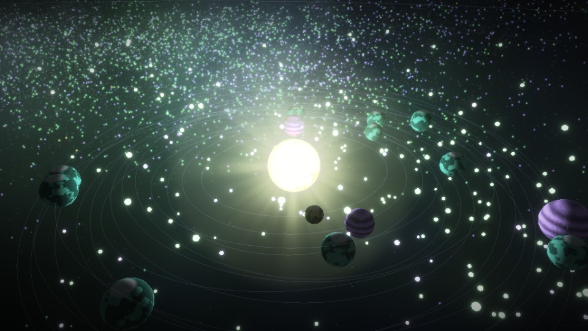
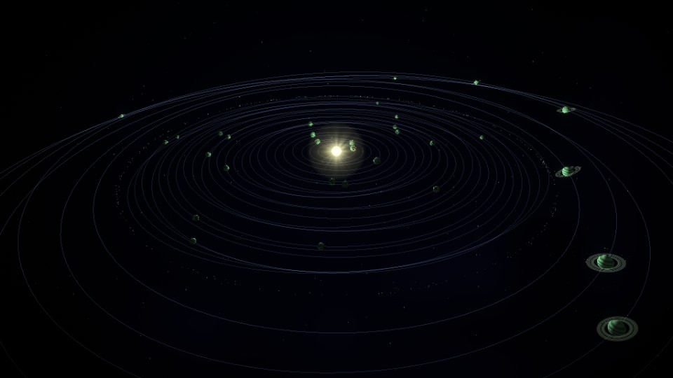
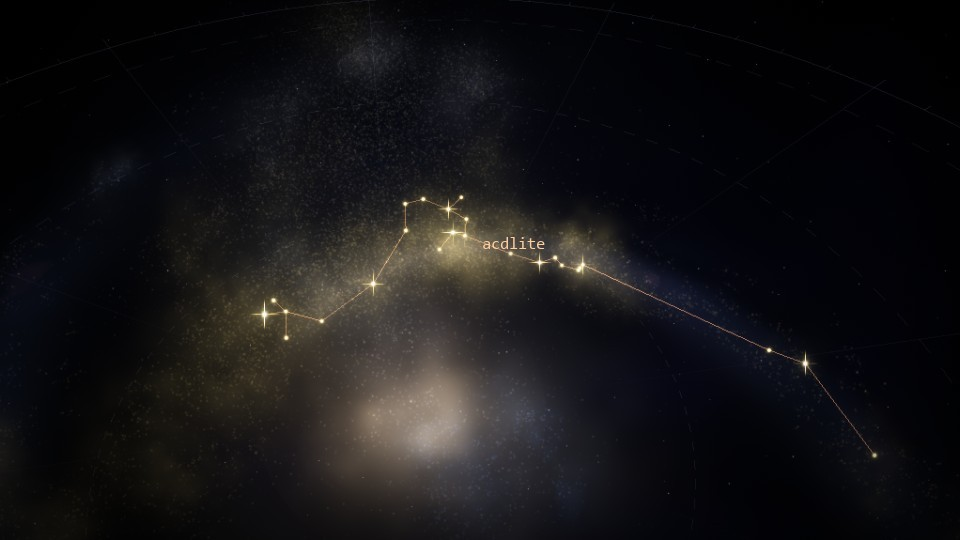
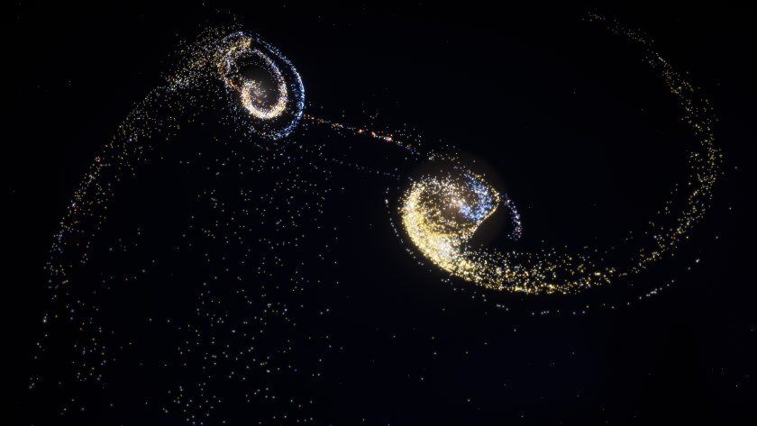
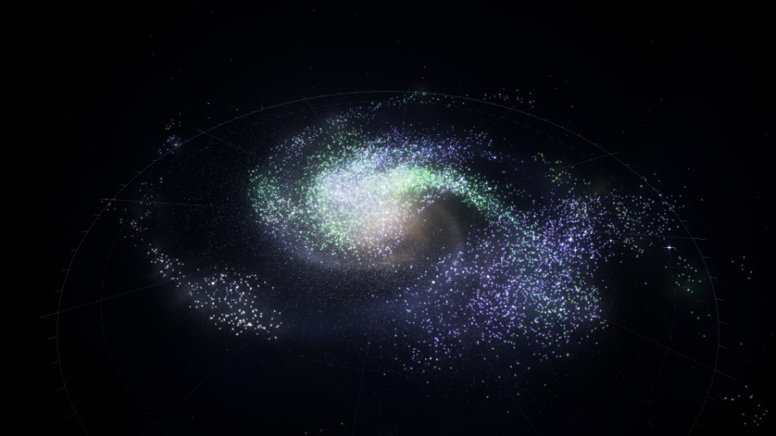

<div align="center">


# Gitsky

**Any GitHub repo, as a galaxy you can fly through.**

Folders are star systems, files are stars, commits are comets.

### [Open Gitsky](https://moazzamaliakamonad-byte.github.io/Gitsky/)


<sub>ollama/ollama: 1,727 files, Go in cyan.</sub>

[](https://moazzamaliakamonad-byte.github.io/Gitsky/?repo=moazzamaliakamonad-byte/Gitsky)

</div>

---

In 30 seconds you can see where a codebase is big, where it's busy, who works where, and
how it grew. Everything runs in your browser: no sign-up, no server, no install.

## Try it

- **A featured sky** (no GitHub requests at all):
  [vite](https://moazzamaliakamonad-byte.github.io/Gitsky/?repo=vitejs/vite),
  [transformers](https://moazzamaliakamonad-byte.github.io/Gitsky/?repo=huggingface/transformers),
  [react](https://moazzamaliakamonad-byte.github.io/Gitsky/?repo=react/react),
  [pytorch](https://moazzamaliakamonad-byte.github.io/Gitsky/?repo=pytorch/pytorch),
  [go](https://moazzamaliakamonad-byte.github.io/Gitsky/?repo=golang/go),
  [cpython](https://moazzamaliakamonad-byte.github.io/Gitsky/?repo=python/cpython),
  [ollama](https://moazzamaliakamonad-byte.github.io/Gitsky/?repo=ollama/ollama),
  [langchain](https://moazzamaliakamonad-byte.github.io/Gitsky/?repo=langchain-ai/langchain),
  [zustand](https://moazzamaliakamonad-byte.github.io/Gitsky/?repo=pmndrs/zustand).
- **Any public repo:** paste `owner/repo` or a GitHub link. Or, on any GitHub page, swap
  `github.com` for `moazzamaliakamonad-byte.github.io/Gitsky` in the address bar.
- **A person:** type `@username` to see their projects and the people they build with.
- **Two repos at once:**
  [react collides with vite](https://moazzamaliakamonad-byte.github.io/Gitsky/?repo=react/react&vs=vitejs/vite).

## Gallery

<table>
  <tr>
    <td width="50%"></td>
    <td width="50%"></td>
  </tr>
  <tr>
    <td><b>A file, up close.</b> Its functions and classes orbit it as planets; the code panel shows the source.</td>
    <td><b>A folder, as a solar system.</b> Files are planets; sub-folders are ringed giants you can warp into.</td>
  </tr>
  <tr>
    <td></td>
    <td></td>
  </tr>
  <tr>
    <td><b>The universe.</b> The people who build a repo and the other projects they build. Expand any of them and the web grows.</td>
    <td><b>Constellations.</b> Pick a contributor and their files join into a constellation in their colour.</td>
  </tr>
  <tr>
    <td></td>
    <td></td>
  </tr>
  <tr>
    <td><b>Collisions.</b> Two repos crash in a gravity simulation: bridges, tidal tails, a merger.</td>
    <td><b>Real repos, real shapes.</b> pytorch: Python in green, C++ in violet, 12,000 stars.</td>
  </tr>
</table>

## Features

**See a codebase at a glance**

- **A galaxy per repo.** Top-level folders sit on spiral arms, biggest near the core; nested
  folders cluster around them. The same repo always looks the same.
- **Stars that mean something.** Colour is the language, size is the file's bytes,
  brightness is how often it changed recently. The busiest files get diffraction spikes.
- **Insights.** A plain-language summary, hottest and largest files, language share, quiet
  folders and contributors. Click anything to fly there.
- **Search.** Every match pulses; Enter flies to the best one. A List view shows the same
  data as a sortable table.

**Watch it change**

- **Deep time.** The whole life of the repo, from the first commit to today: files ignite as
  they're born, deleted ones burn out, and a slider runs across the years.
- **Comets.** The latest commits replay in order, one comet per touched file, coloured by
  author. The most-changed file goes supernova.

**Go closer, or further out**

- **Warp into a folder** and it becomes a solar system. **Select a file** and its contents
  load as planets. Up close, stars stay sharp points of light with real space between them.
- **Zoom out to the universe** of related projects and people; bridges between projects
  glow gold, active projects burn bright, dormant ones cool.
- **Constellations** of contributors, and **collisions** between any two repos.

**Show it off**

- **Share cards.** A 1200×630 image of your current view, ready for link previews, plus a
  link that opens straight to it.
- **README badge.** Put your repo's galaxy one click away from your README (below).
- **Drift.** Press <kbd>D</kbd>: the interface fades and the camera drifts through the
  galaxies on its own. A screensaver for a second monitor.
- **Guided tour.** One click and the camera flies itself through the repo.

**Built for modest hardware and slow connections**

- 50,000 stars at 60 fps on an Intel Iris Xe laptop GPU, with automatic quality downgrade.
- Works offline after the first visit, and installs as an app.
- Keyboard-reachable throughout, respects reduced motion, works on phones.

| Key | Does |
|-----|------|
| <kbd>/</kbd> | Search |
| <kbd>Esc</kbd> | Back one step |
| <kbd>Home</kbd> | Whole galaxy |
| <kbd>D</kbd> | Drift |

## Put your repo in the sky

Add this to your README, with your repo in place of `OWNER/REPO`:

```md
[](https://moazzamaliakamonad-byte.github.io/Gitsky/?repo=OWNER/REPO)
```

The Share dialog in Gitsky gives you the same snippet, already filled in.

## How it works

```
 owner/repo ─▶ GitHub REST API ──────────▶ browser cache ─▶ layout (pure TS) ─▶ WebGL
              (straight from your browser)  (reloads free)    spiral + clusters    one draw call
              ├─ repo meta              1 request             sizes, colours       for every star
              ├─ latest 100 commits     1 request             churn, nebulae       + bloom
              ├─ whole file tree        1 request
              └─ files per commit       1 request each, sized to your remaining quota
```

Without a token GitHub allows 60 requests an hour, so Gitsky reads your remaining quota
first and samples as many commits as it can afford (about 25); with an optional token, up
to 300. The nine featured skies ship as snapshots and cost nothing.

Deep time reads the repo at up to ten moments spread evenly through its history (one
request to count the commits, then two per moment), about 21 requests in all, kept in your
browser afterwards. Featured skies can ship that history prebuilt.

## Privacy

There is **no Gitsky server**. The site is static files on GitHub Pages and your browser
talks to GitHub directly. A token, if you add one, stays in this tab's `sessionStorage` and
is only ever sent to `api.github.com`. No analytics, no cookies.

File contents come from `raw.githubusercontent.com`, avatars from GitHub, and the interface
fonts from Google Fonts. Nothing is sent anywhere else. What Gitsky keeps (repos you've
opened, deep-time histories, the offline copy) stays in your browser, and clearing the
site's data removes it.

## Limitations

History is sampled, sizes are bytes not lines, and GitHub can truncate very large trees.
The full list, including how deep time and constellations are approximate, is in
[LIMITATIONS.md](LIMITATIONS.md).

## Run it locally

```bash
git clone https://github.com/moazzamaliakamonad-byte/Gitsky.git
cd Gitsky
npm install
npm run dev        # http://localhost:5173
npm test           # unit tests, a few seconds
npm run build      # production build in dist/
npm run preview    # serve dist/ (offline mode only works in a production build)
```

- `localhost:5173/pmndrs/zustand` or `?repo=pmndrs/zustand` opens a repo directly;
  `?stress=50000` draws a labelled synthetic sky for performance testing.
- `npm run snapshot -- owner/repo` adds a featured sky, `npm run snapshot:index` rebuilds
  the list for free, and `npm run snapshot:deep -- owner/repo` prebuilds its deep time.
  Set `GITHUB_TOKEN` to go beyond 60 requests an hour.

## Contributing

Issues and pull requests are welcome. See [CONTRIBUTING.md](CONTRIBUTING.md), and
[docs/IDEAS.md](docs/IDEAS.md) for good first issues.

## Author

Built by [@moazzamaliakamonad-byte](https://github.com/moazzamaliakamonad-byte).

## License

[MIT](LICENSE)
