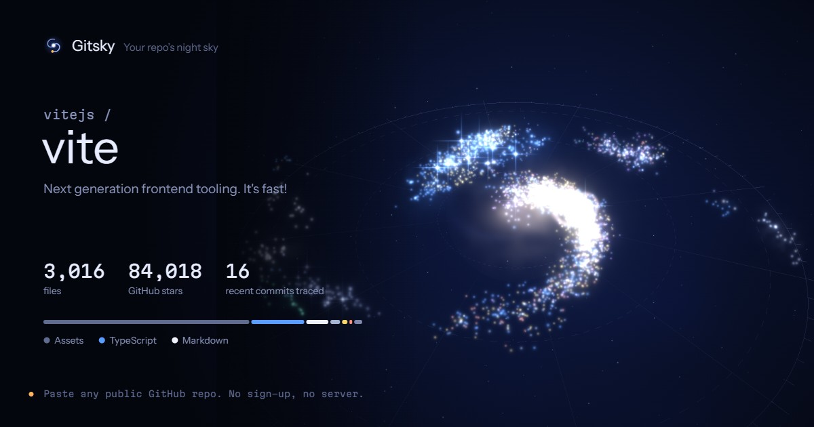

<div align="center">


# Gitsky

**Paste any public GitHub repo and explore it as a living 3D galaxy.**

### [→ Open Gitsky](https://moazzamaliakamonad-byte.github.io/Gitsky/)

<!-- HERO GIF: replace this line with the 6-second clip described in docs/RECORDING.md -->
<!--  -->


</div>

---

Folders are star systems. Files are stars. Recent commits streak in as comets. In 30
seconds you can see where a codebase is big, where it's busy, and where nobody has
touched anything in a while.

## Features

- **Swap the domain.** On any GitHub page, replace `github.com` with
  `moazzamaliakamonad-byte.github.io/Gitsky` and press Enter:
  `github.com/pmndrs/zustand` becomes that repo's sky, and a profile URL opens that
  person's universe.
- **Deep time.** Watch the galaxy form over the repo's whole life: from the first commit to
  today, files ignite as they're born and deleted ones burn out, with a slider across the
  years.
- **Constellations.** Pick a contributor and their files join into a constellation, drawn in
  their colour with their name at its heart.
- **Drift.** Press D and the interface fades: the camera drifts through the galaxy, moving on
  to the next featured sky every minute or so. A screensaver for a second monitor.
- **A guided tour.** One click and the camera flies itself through the repo, explaining what
  it finds, from the largest region to the busiest file to a warp into its folder.
- **A galaxy per repo.** Top-level folders sit on logarithmic spiral arms, biggest near the
  core; nested folders cluster around them. The same repo always looks the same.
- **Stars that mean something.** Colour is the language, size is the file's bytes (log
  scale), brightness and twinkle are how often it changed in the sampled commits.
  The hottest files get diffraction spikes.
- **Comets.** The last N commits replay in order: one comet per touched file, coloured by
  author, flashing its star on arrival. Scrub the timeline to any commit.
- **A supernova.** The most-changed file explodes when its comet lands.
- **Warp into any folder.** It becomes a solar system: its files are planets (most-changed
  closest to the sun), its sub-folders ringed gas giants you can warp into next.
- **Zoom into a file.** Select any star and its contents load: its functions, classes and
  headings orbit it as planets, and a code panel shows the outline and source.
- **Zoom out to the universe.** See the people who build a repo and the other projects they
  build, as a field of galaxies joined by filaments. Expand any galaxy or person and the web
  grows; people who bridge projects glow gold; live projects burn bright, dormant ones cool.
  Type `@username` to see a person's universe.
- **Collide two repos.** `?repo=react/react&vs=vitejs/vite` crashes two galaxies together in a
  gravity simulation: tidal tails, bridges, a merger. Files they share are threaded with light.
- **Understand it in 30 seconds.** A written summary, hottest files, largest files,
  language share, quiet folders and contributors. Click anything to fly there.
- **Find anything.** Search pulses every match; Enter flies to the best one. Hover for
  details, click for a panel with recent commits and a link to the file on GitHub.
- **Share your sky.** Export a 1200×630 poster of your current view, or copy a
  `?repo=owner/name` link that opens straight to it. The Share dialog also has a README
  badge that opens your repo's galaxy.
- **Works offline.** After the first visit Gitsky opens instantly with no network, along
  with every sky you've viewed. Install it as an app from the browser.
- **Open repos straight from GitHub links.** Paste a full URL, `owner/repo` or `@username`;
  the ⌄ beside the repo name switches to another repo or a featured sky.
- **Accessible.** Every control is keyboard-reachable, and a List view shows the same data
  as a sortable table. Respects reduced motion.
- **Fast on modest hardware.** 50,000 stars at 60 fps on an Intel Iris Xe laptop GPU, with
  automatic quality downgrade if frames drop. Works on phones.

## How it works

```
 owner/repo ─▶ GitHub REST API ─────────────▶ IndexedDB cache ─▶ layout (pure TS) ─▶ WebGL
              (from your browser)              (reloads are free)   spiral + clusters    one draw call
              ├─ repo meta                1 call                    sizes, colours       for every star
              ├─ last 100 commits         1 call                    churn, nebulae       + bloom
              ├─ whole file tree          1 call
              └─ files per commit         1 call each, sized to your remaining quota
```

Without a token GitHub allows 60 requests an hour, so Gitsky reads your remaining quota
first and samples as many commits as it can afford (about 25). With an optional token it
samples up to 300.

Nine featured skies are bundled as snapshots and cost no API calls at all: `vitejs/vite`,
`huggingface/transformers`, `react/react`, `pytorch/pytorch`, `golang/go`,
`python/cpython`, `ollama/ollama`, `langchain-ai/langchain` and `pmndrs/zustand`.

**Deep time** reads the repo at up to ten moments spread evenly through its commit history
(one request to count the commits, then two per moment: the commit at that point and its
whole file tree), about 21 requests in all. Featured skies can ship that history prebuilt,
and every history is kept in your browser, so each repo pays once.

## Privacy

There is **no Gitsky server**. The site is static files on GitHub Pages; your browser talks
to `api.github.com` directly. If you add a token, it stays in this browser tab's
`sessionStorage` (gone when you close the tab) and is only ever sent to `api.github.com`.
No analytics, no cookies.

Opening a file reads it from `raw.githubusercontent.com` (no API quota). The Universe view
asks the GitHub API about the repo's contributors and their public repos; the Universe and
People views show public avatars from GitHub. The interface fonts come from Google Fonts.
Nothing is sent anywhere else.

Everything Gitsky keeps, it keeps in your browser: repos you've opened (IndexedDB), Universe
answers and deep-time histories (`localStorage`), and an offline copy of the site and the
skies you've viewed (a service worker cache). Clearing the site's data in your browser
removes all of it.

## Limitations

Gitsky samples recent history, sizes are bytes not lines, and very large trees can be
truncated by GitHub. The full, honest list is in [LIMITATIONS.md](LIMITATIONS.md).

## Run it locally

```bash
git clone https://github.com/moazzamaliakamonad-byte/Gitsky.git
cd Gitsky
npm install
npm run dev        # http://localhost:5173
npm test           # unit tests, a couple of seconds
npm run build      # production build in dist/
npm run preview    # serve dist/ (the offline copy only works in a production build)
```

Useful extras:

- `http://localhost:5173/pmndrs/zustand` (or `?repo=pmndrs/zustand`) opens a repo directly.
- `http://localhost:5173/?stress=50000` draws a labelled synthetic sky for performance testing.
- `npm run snapshot -- owner/repo` fetches a repo into `public/snapshots/` (set
  `GITHUB_TOKEN` for deeper history), and `npm run snapshot:index` rebuilds the index
  without any API calls.
- `npm run snapshot:deep -- owner/repo` prebuilds deep time for a featured sky (about 25
  requests each; with `GITHUB_TOKEN` you can do them all at once).

## Contributing

Issues and pull requests are welcome. See [CONTRIBUTING.md](CONTRIBUTING.md), and
[docs/IDEAS.md](docs/IDEAS.md) for good first issues.

## Author

Built by [@moazzamaliakamonad-byte](https://github.com/moazzamaliakamonad-byte).

## License

[MIT](LICENSE)
